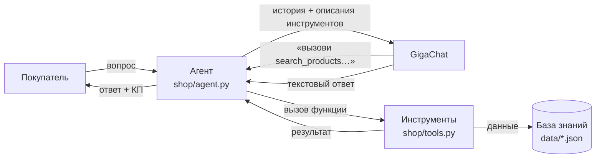

# ИИ-консультант для интернет-магазина

ИИ-агент на **GigaChat** работает консультантом магазина спорттоваров «Старт». Он отвечает покупателям про наличие, цены, размеры, доставку и возврат, а когда покупатель определился, **собирает коммерческое предложение** со скидкой и доставкой и сохраняет его в файл.

Главный принцип: **модель ничего не выдумывает.** Цены, остатки и условия она берёт только из базы магазина через инструменты, а все суммы считает Python, а не нейросеть.

## Что умеет

```
Покупатель:  Нужны беговые кроссовки до 8000, размер 42
Консультант: Нашлись такие варианты:
             Nike Revolution 7 — 6 990 ₽, есть размер 42
             Asics Gel-Contend 9 — 7 490 ₽, есть размер 42 …
Покупатель:  Давайте Nike, соберите КП, доставка курьером
Консультант: КП готово: 6 990 ₽, доставка бесплатно (заказ от 5 000 ₽),
             итого 6 990 ₽. Файл: quotes/КП-20261118-173227.md
```

- Подбор товаров по описанию, бюджету и размеру
- Проверка наличия конкретного размера
- Ответы про доставку, оплату, возврат, гарантию, скидки, примерку
- Сборка КП: скидка 5% от 15 000 ₽ и 10% от 30 000 ₽, бесплатная доставка от 5 000 ₽, файл для клиента
- Честность: если на складе меньше, чем просят, агент говорит об этом и не вписывает в КП то, чего нет

## Почему это агент, а не «один запрос к модели»

У модели есть **4 инструмента**, и на каждом шаге она **сама решает**, какой вызвать и с какими аргументами. Ответ на один вопрос может занять несколько шагов: найти мячи → найти скакалки → собрать КП → ответить.

| Инструмент | Что делает |
|---|---|
| `search_products` | Поиск по каталогу: слова, категория, макс. цена, размер |
| `check_stock` | Остаток товара, в том числе конкретного размера |
| `get_policy` | Условия магазина: доставка, оплата, возврат и т. д. |
| `make_quote` | Собирает КП, считает скидку и доставку, сохраняет файл `.md` |



**Цикл агента** (`shop/agent.py`):
1. Отправляем модели переписку и описания инструментов.
2. Модель либо отвечает текстом, либо просит вызвать функцию.
3. Если просит, вызываем функцию сами, кладём результат в переписку и возвращаемся к шагу 1.
4. Текстовый ответ уходит покупателю. Защита от зацикливания: не больше 6 шагов на вопрос.

В веб-интерфейсе справа есть панель **«Что делает агент»**: видно каждый вызов инструмента, его аргументы и то, что он вернул.

## Стек

- **Модель:** GigaChat 2 Lite (`GigaChat-2`) через официальную библиотеку `gigachat`, вызов функций (function calling)
- **Бэкенд:** Python 3.13, Flask
- **База знаний:** JSON — 24 товара с остатками по размерам и 8 тем условий магазина
- **Тесты:** pytest, 16 тестов на инструменты

## Запуск

```bash
git clone https://github.com/Bratuha1/ai-consultant.git
cd ai-consultant
python -m venv .venv
.venv\Scripts\pip install -r requirements.txt
copy .env.example .env      # и вписать свой ключ GigaChat API
.venv\Scripts\python app.py # открыть http://127.0.0.1:5000
```

Другие режимы:
- `python chat.py` — консольный чат
- `python measure_tokens.py` — замер расхода токенов на типовых разговорах
- `python -m pytest` — тесты

Ключ берётся в [личном кабинете Сбера](https://developers.sber.ru/studio) (GigaChat API, физлицо, scope `GIGACHAT_API_PERS`).

> **Сертификат.** Сейчас подключение идёт с `verify_ssl_certs=False`. Для боевого запуска нужно установить сертификат Минцифры и включить проверку.

## Экономика

### Сколько токенов уходит

Замер — скрипт `measure_tokens.py`, реальные запросы к GigaChat-2:

| Сценарий | Вопросов | Токенов |
|---|---|---|
| Вопрос про доставку и возврат | 1 | 858 |
| Подбор кроссовок + уточнение размера | 2 | 1 116 |
| Подбор + сборка КП | 2 | 1 262 |
| Оптовый запрос для секции | 1 | 819 |
| **В среднем на вопрос** | | **≈ 675** |

Почему токенов больше, чем слов в ответе: у модели нет памяти, поэтому на каждом шаге ей заново отправляется инструкция, описания инструментов и вся переписка. Около 80% токенов — это то, что *отправляем* мы, а не то, что модель *пишет*. Чем длиннее разговор, тем дороже каждый следующий вопрос.

Для расчёта берём **с запасом 6 000 токенов на один диалог** (≈ 5 вопросов, история растёт, бывают лишние шаги агента).

### Сколько это стоит

Цены GigaChat API для юрлиц, pay-as-you-go, синхронный режим, с НДС ([источник](https://developers.sber.ru/docs/ru/gigachat/tariffs/legal-tariffs), цены с 01.02.2026):

| Модель | ₽ за 1 000 токенов | 1 диалог | 100 диалогов/день, мес. | 1 000 диалогов/день, мес. |
|---|---|---|---|---|
| **GigaChat 2 Lite** (используем) | 0,065 | **0,39 ₽** | **1 170 ₽** | **11 700 ₽** |
| GigaChat 2 Pro | 0,5 | 3 ₽ | 9 000 ₽ | 90 000 ₽ |
| GigaChat 2 Max | 0,65 | 3,9 ₽ | 11 700 ₽ | 117 000 ₽ |

Формула: `6 000 токенов × цена за 1 000 / 1 000 × диалогов в день × 30`.

- Lite справляется с задачей, потому что цены и расчёты делают инструменты, а модели остаётся понять вопрос и выбрать инструмент. Pro имеет смысл, только если Lite начнёт путаться на сложных запросах: он в 7,7 раза дороже.
- Минимальный платёж pay-as-you-go — 600 ₽ в месяц.
- Для разработки и пилота хватает бесплатного пакета для физлиц: 250 млн токенов Lite на 12 месяцев ([источник](https://developers.sber.ru/docs/ru/gigachat/tariffs/individual-tariffs)), то есть ≈ 40 000 диалогов.

### Что нужно для внедрения в реальный магазин

1. **Каталог.** Заменить `data/products.json` выгрузкой из учётной системы магазина (1С, CMS, CSV) с регулярным обновлением остатков.
2. **Условия.** Перенести в `data/policies.json` реальные тексты доставки, оплаты и возврата.
3. **Канал.** Подключить к виджету на сайте или к боту в Telegram/VK вместо демо-страницы.
4. **Сервер.** Небольшой VPS: агент лёгкий, вся тяжёлая работа на стороне GigaChat.

## Как можно сэкономить ещё

- **Короткая память:** не отправлять модели старые сырые результаты поиска и хранить только последние сообщения. Ожидаемая экономия на длинных диалогах — в 2–3 раза.
- **Кэш частых вопросов:** «сколько стоит доставка» можно отвечать без модели.

## Ограничения и планы

- Поиск простой, по словам: «беговые кроссовки» находят и зальные. Умный поиск с опечатками и сленгом — следующий проект.
- Разговоры хранятся в памяти сервера и пропадают при перезапуске.
- Агент не оформляет заказ и не принимает оплату, только готовит КП для менеджера.

## Структура

```
app.py               веб-интерфейс (Flask)
templates/index.html страница: чат, панель агента, карточка КП
chat.py              консольный чат
measure_tokens.py    замер токенов для расчёта стоимости
shop/agent.py        агент: промпт, описания инструментов, цикл вызовов
shop/tools.py        инструменты — обычные функции Python
data/                база знаний: товары и условия
tests/               тесты инструментов
quotes/              сюда сохраняются КП (не в репозитории)
```
